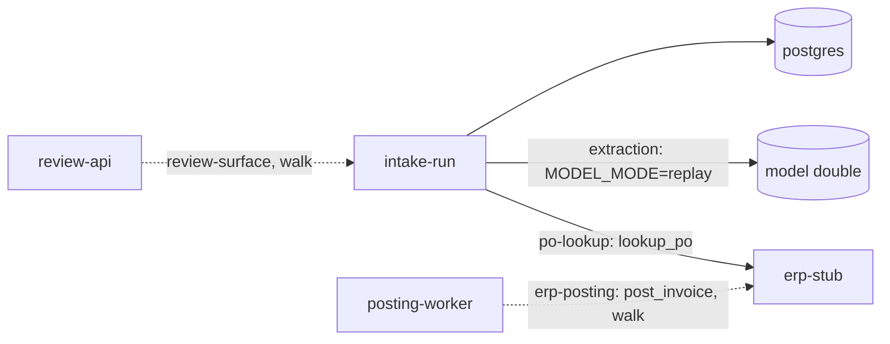

# Workloads

One Python package, one image, one module per architecture workload of **every stage in scope**. The Job or Deployment chooses the command, and the code never hard-codes a stage. `scaffold.yaml` `stage` says where the assembly wires the workload: the first stage whose architecture record lists it, which is `crawl` for a workload Crawl already runs.

## Entrypoint per shape

| Architecture | Module | Runs as | Notes |
|--------------|--------|---------|-------|
| `topology: batch`, `durable_execution: job` | `<pkg>/batch.py` | Job (`phase: run`) | one pass over the seeded or polled inputs; idempotent by the pipeline's `idempotency_key`; exits non-zero on a failed item only when the pipeline's `dead_letter` says the batch must stop |
| `request-response` with `trigger: chat` or `http` | `<pkg>/api.py` | Deployment, `port: 8000`, `health_path: /healthz` | FastAPI; the webhook route verifies the channel's secret header before anything else; a replay route or the replay Job drives it at Crawl |
| `chat-durable`, `durable_execution: temporal` | `<pkg>/worker.py` + `<pkg>/workflows.py` | Deployment | temporalio worker on the bundle's task queue; activities wrap the tools; the API starts workflows |
| any stub integration (`<system>: stub`) | `<pkg>/<system>_stub.py` | Deployment, `port: 8001` | FastAPI; same field set and errors as the real system; records every write it receives so the verify Job can count them |
| always | `<pkg>/seed.py` | Job (`phase: seed`), `<prefix>-seed` | writes the pipeline's `seed_size`, idempotently, with the labels the replay double reads |
| always | `<pkg>/verify.py` | Job (`phase: verify`), named as the quality record's `verify_job` (the gates' `check.ref`, e.g. `inv-validate`) | the quality record's assertions, the KPI line, exit code |
| `trigger: schedule` from Walk | the batch module | CronJob (the assembly writes it) | nothing changes in the code |
| any workload first listed at Walk or Run (`review-api`, `posting-worker`, `escalation-worker`) | `<pkg>/<workload>.py`, `stage: walk` | Deployment or Job at that stage | it starts, answers `/healthz` and `/readyz` against what it will call, reads its config; its business is a `stub` seam (`# SEAM <id>`, `NotImplementedError("backlog ticket T-<id>")`) |

## Configuration contract (`config.py`)

Environment variables only, read once, with defaults that match the Crawl overlay:

```python
@dataclass(frozen=True)
class Settings:
    database_url: str = env("DATABASE_URL")          # built by the assembly from the component Secret keys
    minio_endpoint: str = env("MINIO_ENDPOINT", "minio:9000")
    docling_url: str = env("DOCLING_URL", "http://docling:5001")
    ollama_url: str = env("OLLAMA_URL", "http://ollama-service:11434")
    model_mode: str = env("MODEL_MODE", "live")      # live | replay | rules
    data_class: str = env("DATA_CLASS", "internal")  # from the security record, for the log line
```

Service names are the catalog's (`postgres`, `redis`, `minio`, `docling`, `ollama-service`, `litellm`); the assembly resolves them in the namespace, so the code uses the short name. Secrets arrive through `envFrom` by the component's mounted Secret name (`postgres-secret` → `POSTGRES_USER`, `POSTGRES_PASSWORD`, `POSTGRES_DB`); `config.py` composes the DSN. The key names are the catalog's, never a client library's: read them from `wiki/catalog.json`, `components[].wiring.secret` (`name` and `keys`) for every component the workload mounts. The object store's Secret carries `MINIO_ROOT_USER` and `MINIO_ROOT_PASSWORD`, and an app that reads `MINIO_ACCESS_KEY` because that is what an S3 SDK calls it gets empty credentials, fails its readiness and stalls the seed Job on the cluster while every unit test passes; `scaffold-check.py` flags a mounted Secret whose keys the app never reads. List every variable and secret in `scaffold.yaml` so the assembly knows what to inject.

## Health, shutdown, logging

- `/healthz` returns 200 when the process is up; `/readyz` returns 200 only when every store **and every service the workload calls on its route** answers (the orders stub for an agent that looks orders up, the ERP stub for a poster). The assembly wires `/healthz` as liveness and `/readyz` as readiness and startup probe, so a process that listens only after its database accepts connections is not killed while it waits.
- A replay, seed or verify Job waits on the `/readyz` of every service on its route before its first request (bounded, say 3 minutes, then exit non-zero naming the service): a lookup against a stub still starting turns into a false escalation and a verify that passes or fails by timing.
- SIGTERM stops accepting work and finishes the item in flight; a batch checkpoints by the idempotency key so a restart resumes.
- One JSON log line per event to stdout: `{"ts", "event", "data_class", ...}`; tool and model calls use the line in `tools-and-model.md`. Never the payload.

## Stubs

A stub of an external system is a real HTTP service with the same routes, the same field names and the same error codes the real one has, backed by the seed. It records writes (`POST /postings`, `POST /escalations`) in a table the verify Job reads, so "no write reached the system of record without a token" is a count, not a belief. The real client and the stub share one Protocol; `config.py` picks the base URL.

## Seed

`seed.py` writes exactly what `decisions/data-pipeline.yaml` `seed_size` says, no more: the items, the exceptions by count and kind, the system-of-record fixture the stub serves, and the labels (`<item>.json` next to `<item>.pdf` in the bucket, or a `labels` table) the replay double reads. Drop-and-recreate or upsert by key, so `ephemeral.sh up` can run it again. It prints the counts it wrote.

## Verify

`verify.py` proves the skeleton walks. First one `connected:` check per wired Crawl seam, then the quality record's `verify_assertions` in order: the ones the skeleton makes true as `check`, the ones that need a business rule as `pending`:

```python
STRICT = os.environ.get("VERIFY_STRICT", "0") == "1"    # the Walk overlay sets 1: pending becomes failure
check("connected: po-lookup", stub_calls("lookup_po") == processed)          # the seam reached its double
check("connected: extraction", all(r.fields for r in results))               # the model double answered
check("a second run changes no counts ...", run_once() == first)              # idempotency is contract, not business
check("no posting without an approval token", stub_writes(without_token=True) == 0)
pending("20 items processed, 15 matched, 3 mismatched in review, ...")       # [PENDING] ... -> backlog (or [FAIL] under STRICT)
kpi("straight_through_rate", matched / processed)       # prints KPI straight_through_rate=0.75 from what the double decided
evaluate("field_accuracy", accuracy_against_labels())    # prints EVAL field_accuracy=1.0
```

Each `pending` assertion is listed in `scaffold.yaml` `skeleton.verify.pending` with the seams that will make it true, so `backlog.py` writes its ticket. When the seed's labels can carry the outcome (the replay double returns "mismatch" for the three mismatched items), the count is a `check`, not a `pending`: the routing is proven and only the rule that would compute the label is backlog. `[PASS]`/`[FAIL]`/`[PENDING]` per line, the failing assertion named, exit 1 when any failed. It reads endpoints from the environment the assembly sets from `usecase.yaml` and nothing outside the namespace. The idempotency assertion calls the run step a second time from inside the Job (the batch module exposes `run_once()` for that), so the proof does not depend on the operator.

## Connection diagram

`app/docs/connections.md`: one Mermaid `graph LR` that names every workload of every stage, every store, queue, model route and external system, with each edge labelled by the seam id and the tool or call behind it. Later-stage edges are dashed. `scaffold-check.py` requires every workload name and every seam to appear in it. It is the first thing the agent team reads: which ticket touches which wire.



